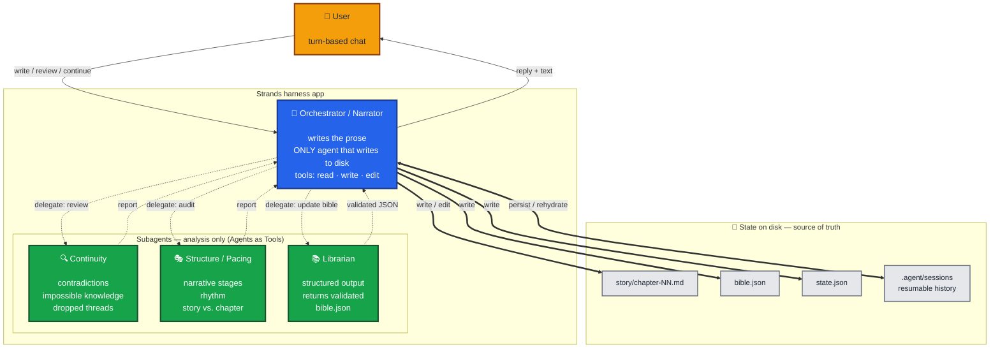

# mini-Sherpa — Narrador de historias con Strands Agents Harness 🐸

Un narrador de historias construido con [Strands Agents Harness](https://strandsagents.com/),
inspirado en Sherpa de Pocket FM pero reducido a lo esencial: **solo texto**, sin audio
ni imágenes. Le pedís un cuento o una novela, te hace una breve entrevista (formato,
género, tono, personajes, premisa) y se pone a escribir.

No es un solo agente, sino un **conjunto de agentes** trabajando como un pequeño taller
literario:

- **Orquestador / Narrador** (Gemini): conduce la conversación, escribe la prosa y es el
  único que escribe en disco.
- **continuidad** (Nova Lite): revisa contradicciones contra la "biblia" de la historia.
- **estructura** (Nova Lite): audita las etapas narrativas y el ritmo.
- **bibliotecario** (Nova Lite): mantiene la biblia (`bible.json`) con *structured output*.

El estado vive en **archivos**: capítulos en `story/`, la biblia en `bible.json`, el
avance en `state.json`, y el historial de conversación en la sesión del harness
(reanudable).


### La arquitectura: un orquestador y tres subagentes



## Archivos

- `narrador_spa.py` — el narrador, con prompts y comentarios en **español**.
- `narrador_eng.py` — la **misma** versión con todo en **inglés**.
- `requirements.txt` — dependencias para correrlo.
- [`docs/minisherpa_requerimientos.md`](docs/minisherpa_requerimientos.md) — los requerimientos del caso de uso.
- [`docs/mini_sherpa_agent_architecture.svg`](docs/mini_sherpa_agent_architecture.svg) — diagrama de la arquitectura de agentes.

## Requisitos

- **Python 3.10+**
- Una **API key de Google Gemini** (para el orquestador): https://aistudio.google.com/apikey
- **Credenciales de AWS** con acceso a Amazon Bedrock (para los subagentes Nova Lite),
  en la región `us-east-1`.

## Cómo ejecutarlo

1. Crear y activar un entorno virtual, e instalar dependencias:

   ```bash
   python -m venv .venv
   # Windows (PowerShell):
   .\.venv\Scripts\Activate.ps1
   # Linux / macOS:
   source .venv/bin/activate

   pip install -r requirements.txt
   ```

2. Crear un archivo `.env` con tu clave de Gemini:

   ```
   GEMINI_API_KEY=tu_clave_real
   ```

   (Las credenciales de AWS se toman de tu configuración habitual: perfil en
   `~/.aws/credentials`, variables de entorno, o rol.)

3. Correr el narrador (elegí la versión en tu idioma):

   ```bash
   python -u narrador_spa.py    # español
   python -u narrador_eng.py    # inglés
   ```

   Escribí tu pedido en el prompt (`✍`). El narrador escribe **un capítulo por turno** y
   se detiene: podés editar los archivos a mano y pedirle `revisar` o `continuar`. Para
   salir: `salir` (o `exit`).
   
## Referencias
- [Sumergiéndonos en Strands Harness 🐬: lo que la documentación no te cuenta](https://builder.aws.com/content/3KSzL85OExqpS03po5ah858ZxGA/sumergiendonos-en-strands-harness-lo-que-la-documentacion-no-te-cuenta)
- [Stop Starting From Scratch: Build Agents with Strands harness (AWS Builder)](https://builder.aws.com/content/3JgWF0T6PorfoRq7EdgkwO3F96P/stop-starting-from-scratch-build-agents-with-strands-harness)
- [Introducing Strands harness: frontier performance with 28% lower token cost (blog oficial)](https://strandsagents.com/blog/introducing-strands-harness/)
- [Documentación oficial de Strands Agents](https://strandsagents.com/)
- [Strands Harness - Developer Guide](https://docs.aws.amazon.com/bedrock-agentcore/latest/devguide/harness.html)
   
   
